# DevOps & Cloud Engineering — Reddit Sentiment Analyzer

> Containerizing, automating, testing, and orchestrating a full-stack web application on AWS, from Docker Compose to a Jenkins CI/CD pipeline with Selenium tests to Kubernetes with autoscaling.

**Context:** Hands-on DevOps coursework (CSC483, Fall 2025), built in five stages on one real application, the Reddit Sentiment Analyzer.
**Note:** The AWS EC2 instances used for these deployments were temporary and are no longer running, so live demo links are not available. The screenshots below document each stage.

## The Application

| Layer | Technology |
|---|---|
| Frontend | React, served by Nginx |
| Backend | FastAPI (Python) |
| Database | PostgreSQL |

Users sign up and log in, then enter a subreddit or Reddit URL on the dashboard to fetch posts and visualize their sentiment. Analysis history is stored in the database.

🔗 Application code: [reddit-sentiment-analyzer](https://github.com/fizaf0012/reddit-sentiment-analyzer)
🔗 Automated tests: [reddit-selenium-tests](https://github.com/fizaf0012/reddit-selenium-tests)

## Tech Stack

AWS (EC2, S3, Elastic Beanstalk, RDS) · Docker · Docker Compose · Docker Hub · Jenkins · Jenkinsfile (Pipeline as Code) · GitHub · Selenium · pytest · Kubernetes (Minikube) · kubectl · Horizontal Pod Autoscaler · Nginx · Linux (Ubuntu)

---

## Stage 1 — Deploying on AWS: IaaS and PaaS

The same application deployed two ways, to compare the infrastructure and platform service models.

### Part I: IaaS with Amazon EC2
- Launched an **Ubuntu EC2 instance**, configured **security group rules** (SSH, HTTP/HTTPS, application ports), and connected over **SSH**.
- Installed and configured the stack with `apt`: **Python, PostgreSQL, Node.js, Nginx, Git**.
- Cloned the repository, set up the **PostgreSQL schema**, ran the **FastAPI** backend, built the **React** frontend, and served it with **Nginx**.

| EC2 instance | Security group rules |
|---|---|
| 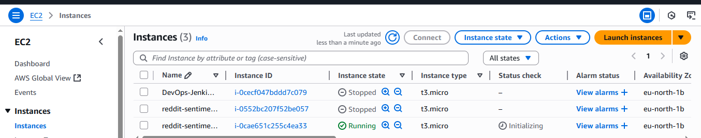 | 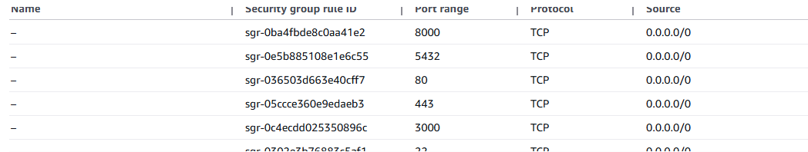 |

| App login on EC2 | Dashboard on EC2 |
|---|---|
| 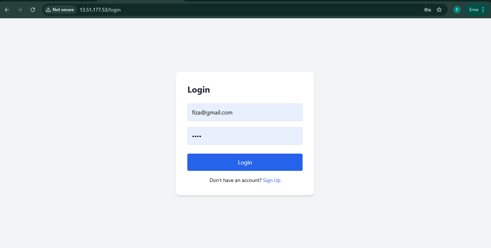 | 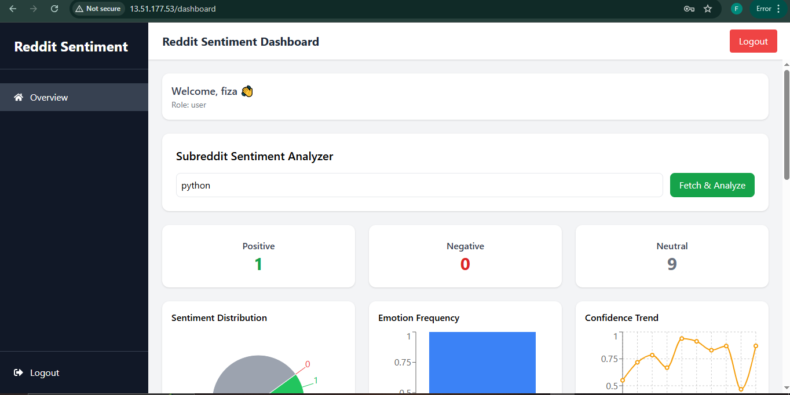 |

Server setup screenshots

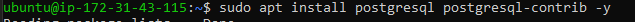
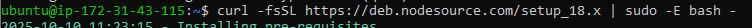
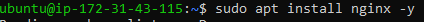
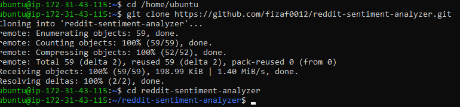
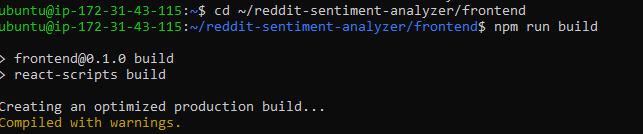

### Part II: PaaS with Elastic Beanstalk, S3, and RDS

| Layer | AWS service |
|---|---|
| Backend (FastAPI) | **AWS Elastic Beanstalk** (Python 3.12) |
| Frontend (React build) | **Amazon S3** static website hosting |
| Database | **Amazon RDS** (PostgreSQL) |

- Installed and configured the **AWS CLI** and **EB CLI**, then created the environment with `eb init` and `eb create`.
- Wrote the Elastic Beanstalk configuration (`.ebextensions`, `Procfile`, pinned `requirements.txt`).
- Created an **RDS PostgreSQL** instance and opened its security group to the backend.
- Kept **API credentials out of the code**, passing them as Elastic Beanstalk environment variables.
- Built the React app, pointed it at the Beanstalk backend URL, and deployed it to an **S3 bucket** with a public-read bucket policy.
- **Trade-off:** because of Elastic Beanstalk free-tier storage limits, the large ML packages (PyTorch, Transformers) were left out of the PaaS deployment, and it uses **VADER** sentiment analysis instead.

| RDS PostgreSQL | Elastic Beanstalk status |
|---|---|
| 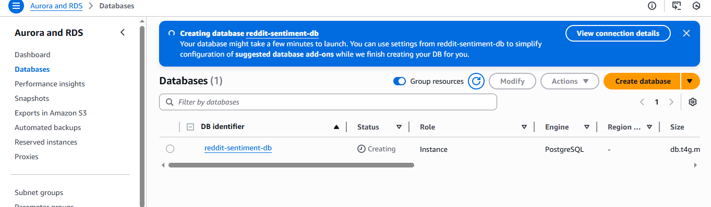 | 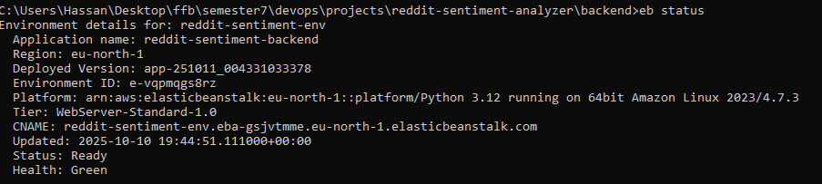 |

| Backend API docs | Frontend hosted on S3 |
|---|---|
| 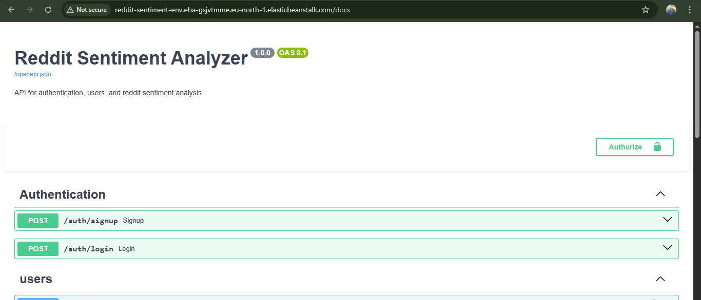 | 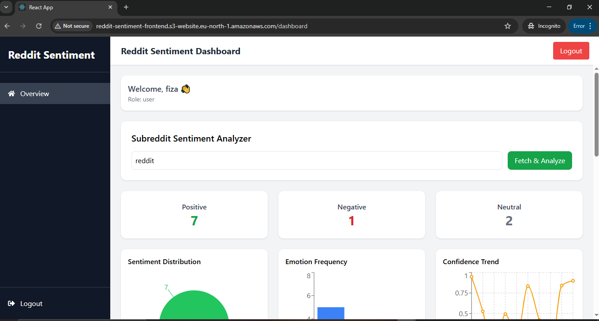 |

More screenshots

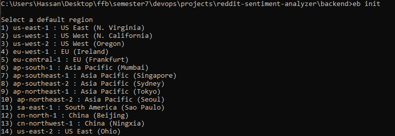
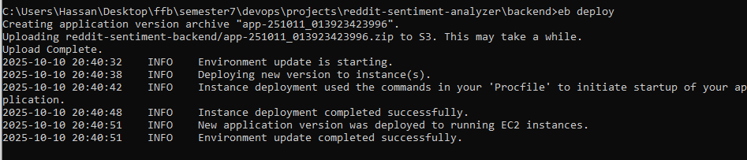
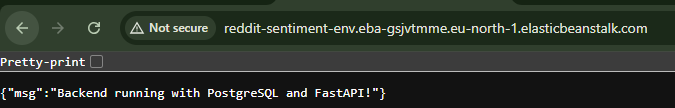
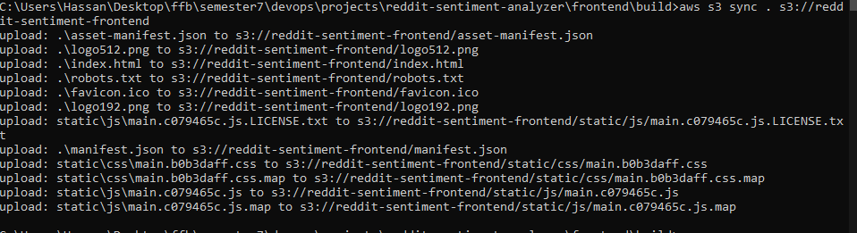

> The ports in the security group above were opened broadly for the assignment demo. In a production setup I would restrict the database port to the application's security group and put HTTPS in front.

---

## Stage 2 — Containerized Deployment on AWS

- Wrote a **Dockerfile for the FastAPI backend** (`python:3.10-slim`, served with Uvicorn).
- Wrote a **multi-stage Dockerfile for the React frontend**: build with `node:16-alpine`, serve the static build with `nginx:alpine` using a custom `nginx.conf`.
- Defined the whole stack in **Docker Compose**: PostgreSQL 15 with a persistent volume, a database health check, a shared bridge network, and startup ordering (`depends_on` with `service_healthy`).
- Pushed the backend and frontend images to **Docker Hub**.
- Provisioned an **AWS EC2** Ubuntu server, installed Docker and Docker Compose, and ran the full stack there.

| Compose build | Docker Hub repositories |
|---|---|
| 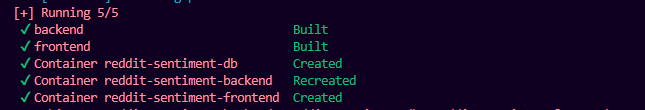 | 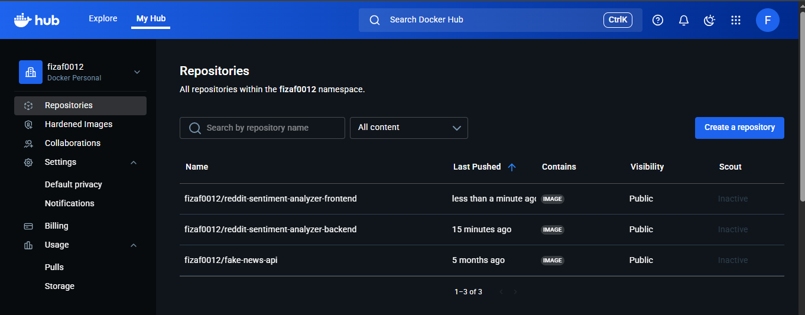 |

More screenshots

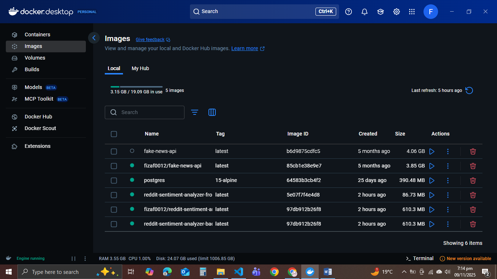
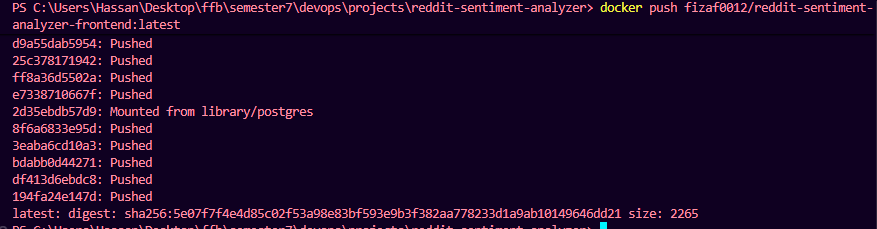
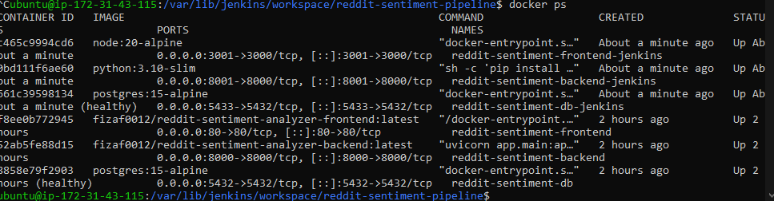

---

## Stage 3 — CI/CD Pipeline with Jenkins

- Installed **Java and Jenkins** on the EC2 server and opened the required port in the AWS security group.
- Installed the required Jenkins plugins for Docker and GitHub integration.
- Created a **declarative Jenkins Pipeline** (Jenkinsfile) that checks out the code from GitHub, stops old containers, then builds and deploys the stack using a dedicated Compose file.
- Added the `jenkins` user to the Docker group so the pipeline can run Docker commands.
- Verified the pipeline with a successful automated build.

| Pipeline job | Successful build |
|---|---|
| 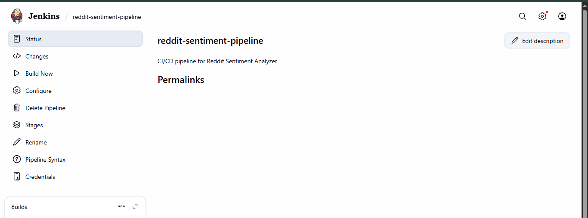 | 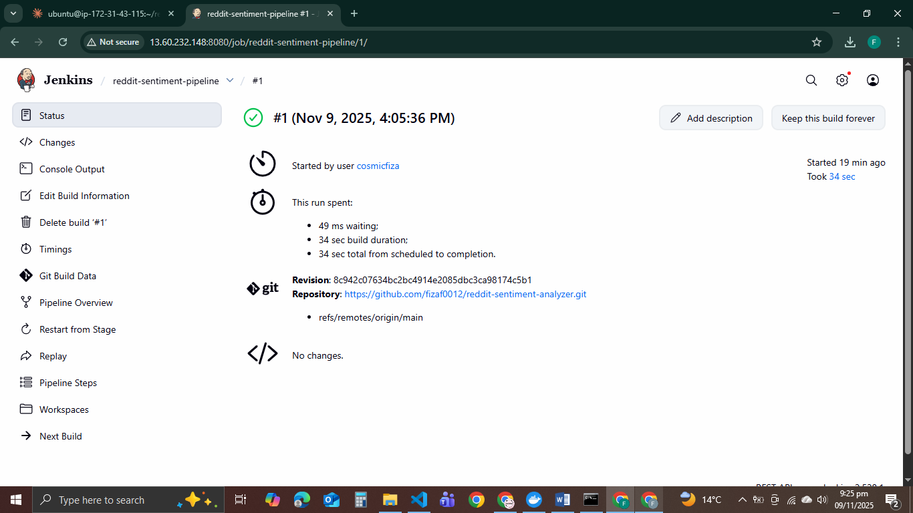 |

More screenshots

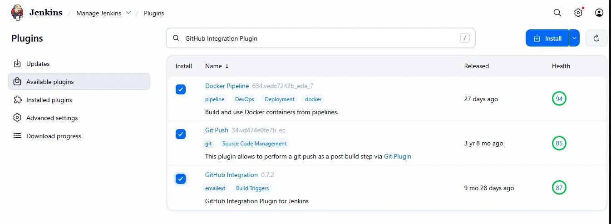
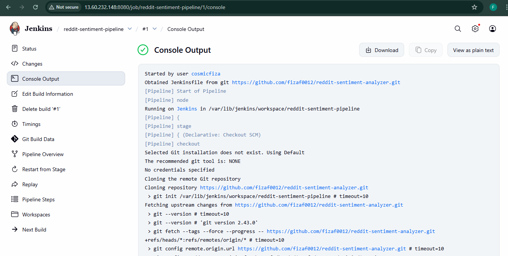

---

## Stage 4 — Automated Testing in the Pipeline

Wrote **10 automated UI test cases** with **Selenium** and **pytest**, using headless Chrome and WebDriver Manager, and added a **test stage** to the Jenkins pipeline that publishes an HTML test report.

| # | Test case |
|---|---|
| 1 | Signup page loads with all form fields |
| 2 | User registration with valid data (unique timestamp-based credentials) |
| 3 | Login page loads |
| 4 | Login with valid credentials |
| 5 | Dashboard accessible after login |
| 6 | Reddit input field exists on dashboard |
| 7 | Analyze button exists |
| 8 | History page accessible |
| 9 | Invalid credentials are rejected |
| 10 | Logout works and redirects to login |

| pytest HTML report | Jenkins build with test stage |
|---|---|
| 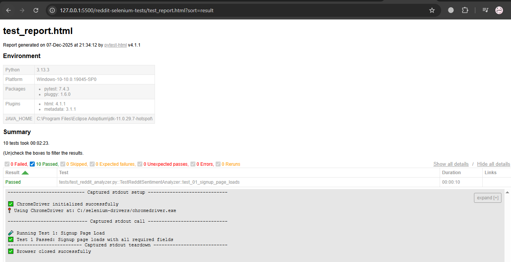 | 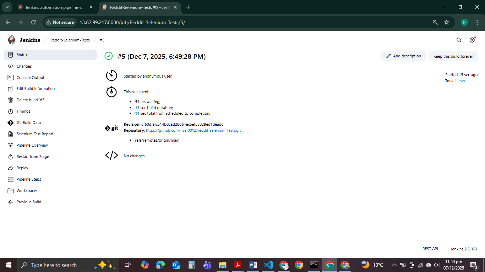 |

Jenkinsfile test stage

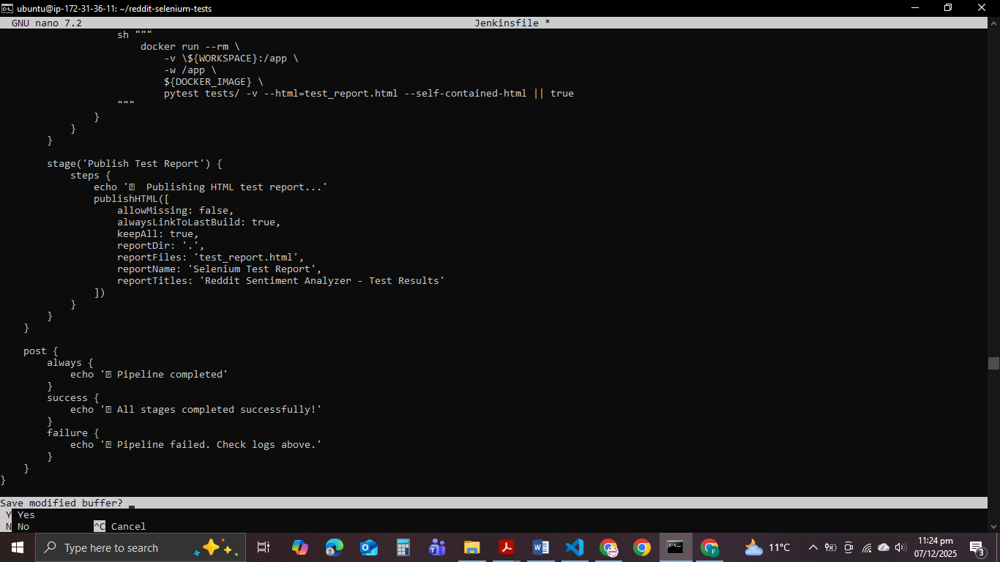

---

## Stage 5 — Kubernetes Orchestration (Minikube on AWS EC2)

Moved the application from Docker Compose to a **Kubernetes cluster** running on EC2 with Minikube.

- Wrote Kubernetes manifests for: a **PersistentVolumeClaim**, PostgreSQL **Deployment and Service**, backend **Deployment and Service**, frontend **Deployment and Service**, and a **HorizontalPodAutoscaler**.
- Used a **PersistentVolume** so database data survives pod restarts.
- Configured **Nginx as a reverse proxy**: the frontend forwards `/api/` calls to the backend service.
- Set **resource requests/limits** and enabled **autoscaling** on CPU and memory utilization for the backend.
- Exposed the app externally with secure tunnels (Serveo for the frontend, ngrok for the Kubernetes Dashboard).
- Verified the deployment with `kubectl` and the Kubernetes Dashboard.

### Architecture

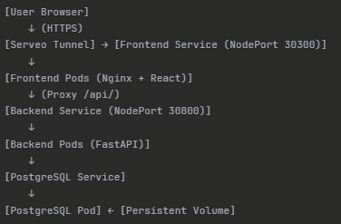

| App running on Kubernetes | Kubernetes Dashboard |
|---|---|
| 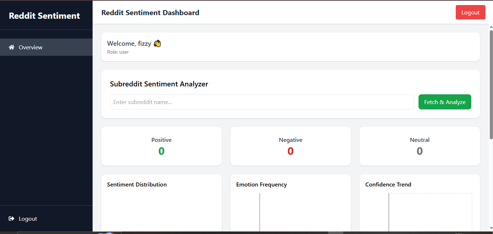 | 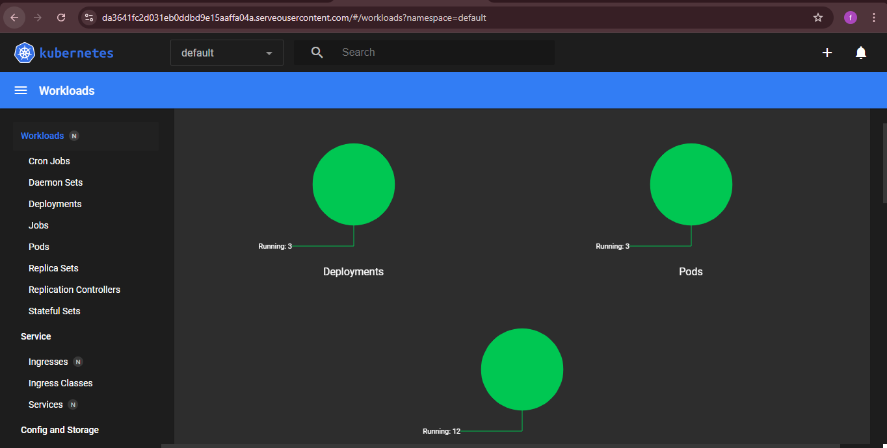 |

More screenshots

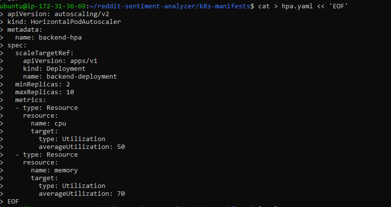
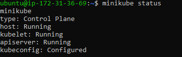
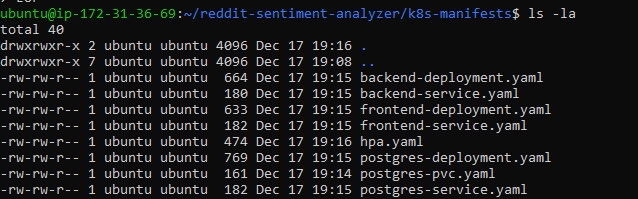
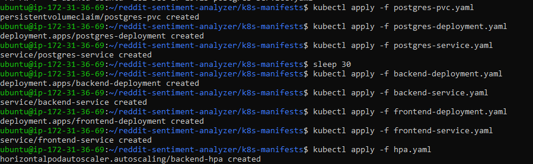
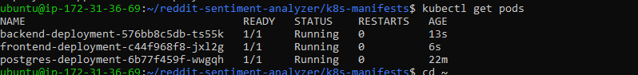
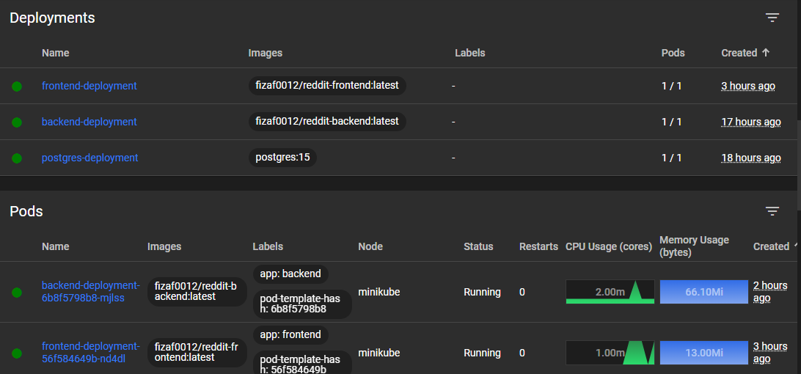
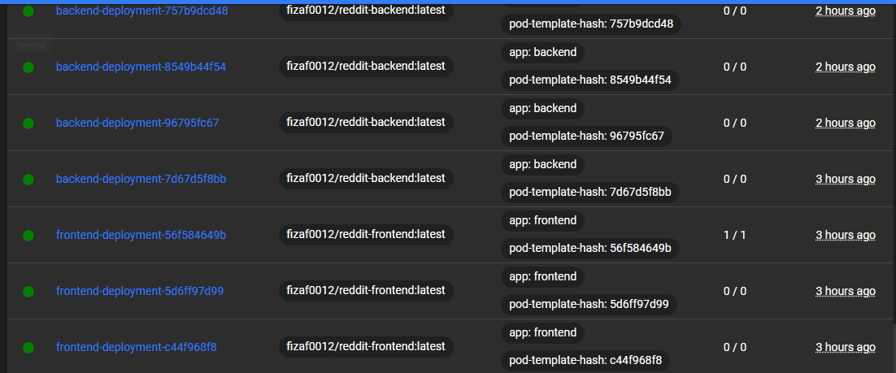

---

## What I Learned

- Deploying the same app with IaaS (EC2) and PaaS (Elastic Beanstalk, S3, RDS) and comparing the trade-offs.
- Packaging a multi-service application (frontend, backend, database) with Docker and Compose.
- Automating build, test, and deploy with a Jenkins pipeline defined as code.
- Writing automated UI tests and running them as a quality gate in CI/CD.
- Running a stateful application on Kubernetes with persistent storage, service networking, and autoscaling.
- Deploying and operating Linux servers on AWS EC2.

[⬅ Back to Portfolio](../../README.md)
